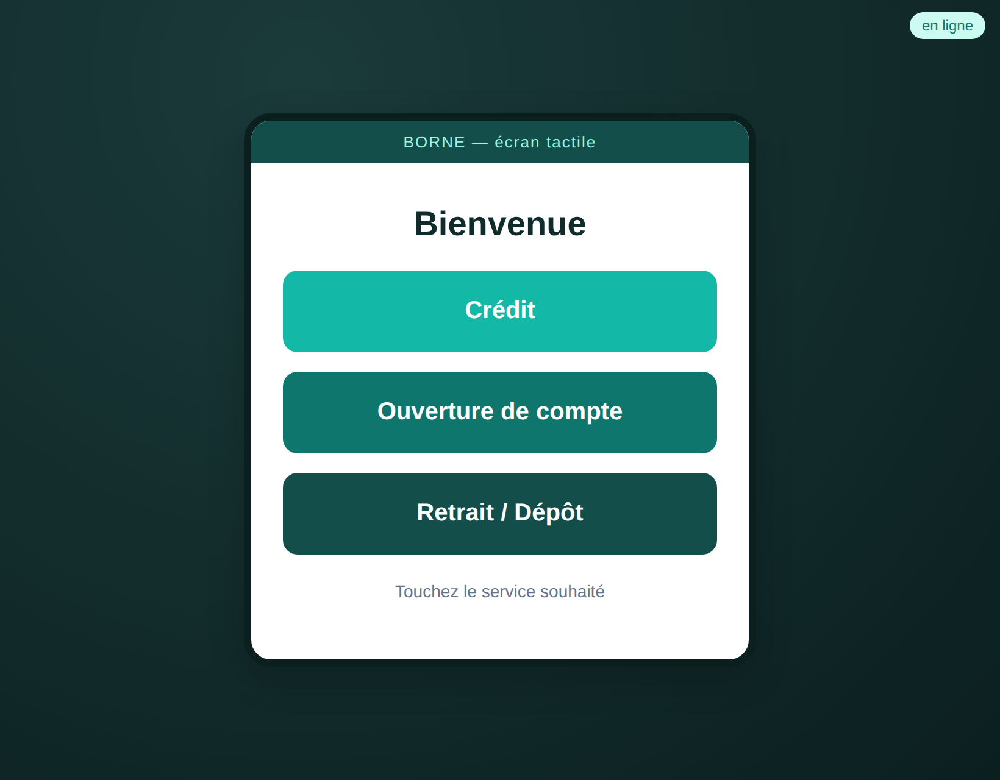
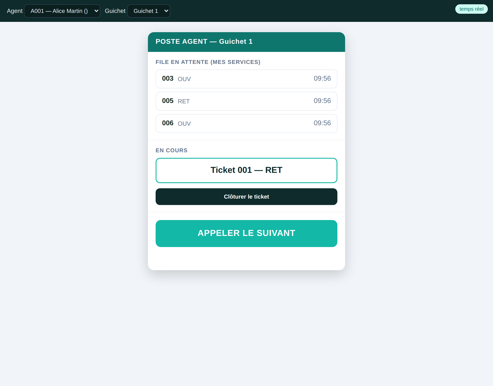
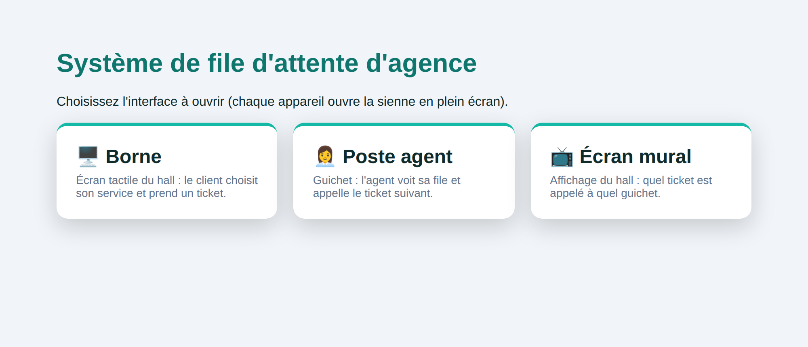

# 🎫 Système de file d'attente d'agence

> Gestion de file d'attente pour une agence : **borne** de prise de ticket, **poste agent** pour appeler les clients, et **écran mural** qui s'actualise en temps réel.


Implémentation complète du **dossier de conception (Phase 2)** — la mise en œuvre suit
fidèlement les modèles (MCT/MOT, diagramme de classes, séquences, états, contrats).
📄 **[Dossier de conception (PDF)](docs/Dossier-de-conception.pdf)**

---

## ✨ Fonctionnalités

- 🖥️ **Trois interfaces** dédiées : borne, poste agent, écran mural (mode kiosque navigateur).
- ⚡ **Temps réel** : quand un agent appelle le ticket suivant, l'écran mural s'actualise
  **instantanément** via WebSocket (repli automatique en polling 2 s).
- 🔐 **Habilitations** : chaque agent ne traite que les services pour lesquels il est habilité.
- 🎯 **Priorité configurable** : règle « le plus ancien en attente » encapsulée (patron Stratégie).
- 🧹 **Traitements automatiques** : détection des abandons (toutes les 5 min) et
  statistiques nocturnes (chaque nuit à minuit).
- 🔄 **SGBD interchangeable** : SQLite en développement, MySQL en cible — **sans toucher
  au code métier** (bascule par variable d'environnement).

## 🧩 Les trois interfaces

| Interface | URL | Rôle |
| --- | --- | --- |
| 🎟️ **Borne** | `/borne/` | Le client choisit un service et retire un ticket numéroté |
| 👩‍💼 **Poste agent** | `/poste/` | L'agent (avec son guichet) appelle le suivant et clôture les tickets |
| 📺 **Écran mural** | `/mural/` | Affiche les tickets appelés, actualisé en temps réel |

## 🖼️ Aperçu

**Écran mural** — affichage du hall, actualisé en temps réel (patron Observateur) :


| 🎟️ Borne (prise de ticket) | 👩‍💼 Poste agent (file + appel) |
| --- | --- |
|  |  |

**Accueil** — choix de l'interface à ouvrir :



## 🚀 Démarrage rapide

```bash
git clone https://github.com/scannerftl/file-attente.git
cd file-attente
npm install
npm start
```

Puis ouvrir dans un navigateur :

- Accueil : <http://localhost:3000/>
- Borne : <http://localhost:3000/borne/>
- Poste agent : <http://localhost:3000/poste/>
- Écran mural : <http://localhost:3000/mural/>

> 💡 **Démo** : ouvrez la borne, le poste et l'écran mural côte à côte. Prenez un ticket
> sur la borne → il apparaît dans la file du poste ; cliquez « Appeler le suivant » →
> l'écran mural se met à jour instantanément.

### Référentiel de démonstration (seed)

- **Services** : `RET` (Retrait/Dépôt) · `OUV` (Ouverture de compte) · `CRE` (Crédit)
- **Agents** : `A001` Alice (RET, OUV) · `A002` Bob (RET, CRE) · `A003` Chloé (tous)
- **Guichets** : 1, 2, 3

## 🏗️ Architecture en 3 couches

```
public/              ← PRÉSENTATION : IHM Borne / Poste agent / Écran mural
server/api/          ← Contrôleurs HTTP minces (traduisent HTTP ⇄ métier)
server/ws/           ← Adaptateur WebSocket (patron Observateur)
server/metier/       ← MÉTIER : GestionnaireFile, GestionHabilitation,
                       ServiceNotification, Statistiques, StrategiePriorite
server/dao/          ← ACCÈS DONNÉES : le SEUL endroit qui contient du SQL
server/db/connexion/ ← Abstraction Connexion + adaptateurs SQLite & MySQL
server/db/sql/       ← Schémas (MPD) et seed, un fichier par dialecte
```

**Contrat inter-couches** : l'IHM n'appelle que le `GestionnaireFile` ; seules ces
opérations appellent les DAO ; **aucune requête SQL hors des DAO**.

### Patrons de conception retenus

- **Observateur** — `server/metier/ServiceNotification.js` : les écrans muraux s'abonnent ;
  le serveur pousse chaque événement via WebSocket.
- **DAO** — `server/dao/*` : isole le SQL derrière une interface `Connexion` asynchrone,
  implémentée par `SqliteConnexion` (better-sqlite3) et `MysqlConnexion` (mysql2).
- **Stratégie** — `server/metier/StrategiePriorite.js` : la règle de priorité est
  encapsulée et interchangeable.

## 🛠️ Stack technique

| Couche | Choix | Mise en œuvre |
| --- | --- | --- |
| Interfaces (borne, poste, écran) | HTML / CSS / JavaScript | `public/` (kiosque navigateur) |
| Serveur (métier) | Node.js | `server/` (Express) |
| SGBD | SQLite (dev) → MySQL (cible) | `better-sqlite3` **et** `mysql2`, bascule par config |
| Communication client ⇄ serveur | API HTTP + JSON | `server/api/` |
| Push vers les écrans | WebSocket (repli polling 2 s) | `server/ws/` + `public/shared/api.js` |

## ⚙️ Configuration

Copier `.env.example` en `.env` (ou exporter les variables). Principales options :

| Variable | Défaut | Description |
| --- | --- | --- |
| `PORT` | `3000` | Port HTTP |
| `DB_DRIVER` | `sqlite` | `sqlite` (dev) ou `mysql` (cible) |
| `DELAI_ABANDON_MIN` | `5` | Délai (min) avant qu'un ticket appelé non clôturé soit abandonné |
| `MYSQL_*` | — | Hôte, port, user, mot de passe, base (si `DB_DRIVER=mysql`) |

## 🐬 Basculer vers MySQL

La couche métier ne change pas : on choisit le SGBD par variable d'environnement.

```bash
# 1) Créer la base
mysql -u root -p -e "CREATE DATABASE file_attente CHARACTER SET utf8mb4;"

# 2) Initialiser schéma + référentiel
DB_DRIVER=mysql MYSQL_USER=root MYSQL_PASSWORD=motdepasse npm run init-db

# 3) Test de fumée : rejoue un cycle métier complet sur MySQL
DB_DRIVER=mysql MYSQL_USER=root MYSQL_PASSWORD=motdepasse npm run test:mysql

# 4) Démarrer sur MySQL
DB_DRIVER=mysql MYSQL_USER=root MYSQL_PASSWORD=motdepasse npm start
```

Seuls **3 fichiers** diffèrent entre les deux SGBD : `MysqlConnexion.js`,
`schema.mysql.sql` et `seed.mysql.sql`. Tout le reste (DAO, métier, IHM, API) est
identique — la conception était indépendante de la technique.

> `mysql2` est déclaré en `optionalDependencies` : le mode SQLite fonctionne même
> sans lui (chargement paresseux du driver).

## 📏 Règles de gestion implémentées

| Règle | Où |
| --- | --- |
| **RG2** — le plus ancien en attente | `StrategiePriorite` + `TicketDAO.plusAncienEnAttente` |
| **RG3** — parmi les services habilités | `GestionHabilitation` |
| **RG5** — n° = max du jour + 1 (repart à 1 chaque jour) | `GestionnaireFile.prendreTicket` |
| **RG6** — abandons (appelés non clôturés > délai) | `GestionnaireFile.marquerAbandons` (job 5 min) |
| **RG7** — heure_fin > heure_appel | `GestionnaireFile.cloturerTicket` |

## ✅ Tests de recette

```bash
npm test
```

`test/recette.test.js` implémente les tests **T1 → T8** (sur SQLite en mémoire).
Pour vérifier l'adaptateur MySQL, voir `npm run test:mysql` ci-dessus.

## 🖥️ Déploiement Windows

Des scripts prêts à l'emploi et un guide pas à pas sont fournis dans
[`deploiement/`](deploiement/) (installation des dépendances, initialisation MySQL,
ouverture du pare-feu, démarrage, installation en service).

## 📄 Licence

[MIT](LICENSE)
